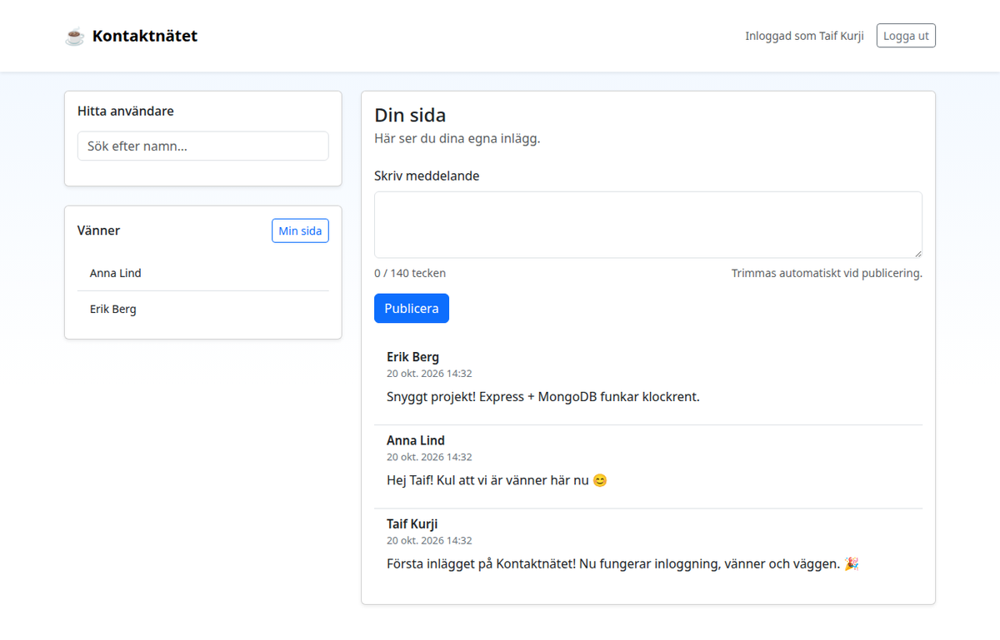
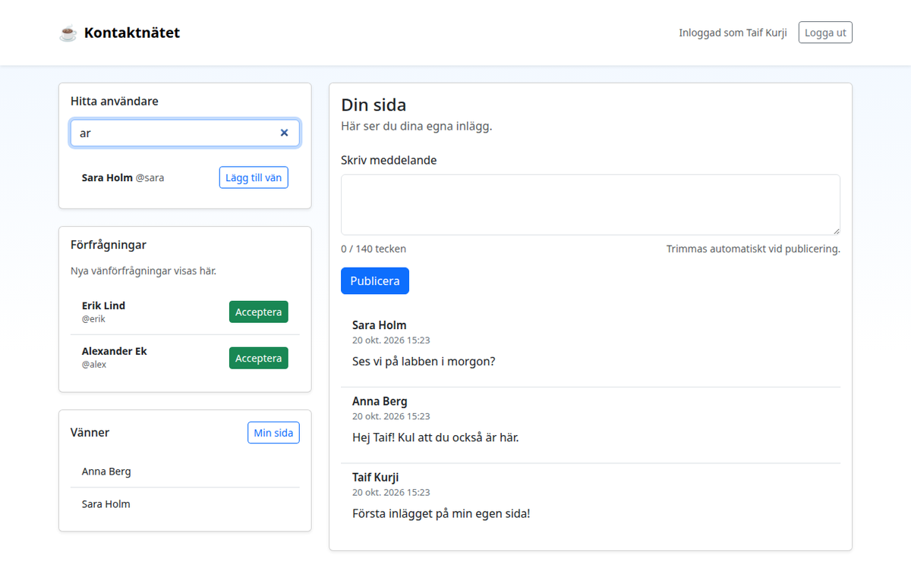

# Social network

A small social network built in a team of 2: a Node.js/Express server with MongoDB and a plain HTML, CSS and JavaScript client. You can register, log in, search for users, send and accept friend requests, and write posts on your own page and on your friends' pages.



## How it is built

- `server/` – Express 5 with layers for routes, services and repositories. Passwords are hashed with bcrypt, login uses a JWT in an httpOnly cookie, and input is validated on both the client and the server. `src/routes/app.spec.js` is an end-to-end test of the API (Mocha, Chai, Supertest, coverage with c8).
- `client/` – a single page in HTML, CSS and JavaScript that calls the API with `fetch`.



## Tech stack

Node.js, Express, MongoDB, JWT, bcrypt, Mocha, HTML, CSS, JavaScript, REST.

## Running it

Needs Node.js 18+ and a MongoDB server on `localhost:27017`.

```bash
cd server
cp .env.example .env    # then set JWT_SECRET to a long random string
npm install
npm start               # API on http://localhost:4000
npm test
```

Serve the client on port 8080 (it must match `CLIENT_ORIGIN` in `.env`):

```bash
cd client
python3 -m http.server 8080 --bind 127.0.0.1
```

Then open http://127.0.0.1:8080/.

Built as a course project at Linköping University (TDP013).

More of my projects: https://tdp003-2024-taiku983.kubernetes-public.it.liu.se/
